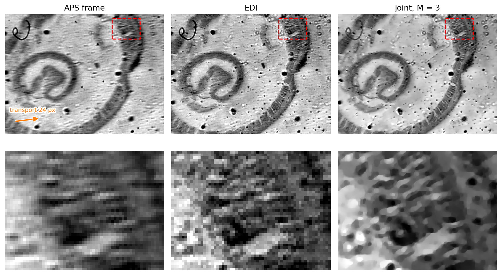
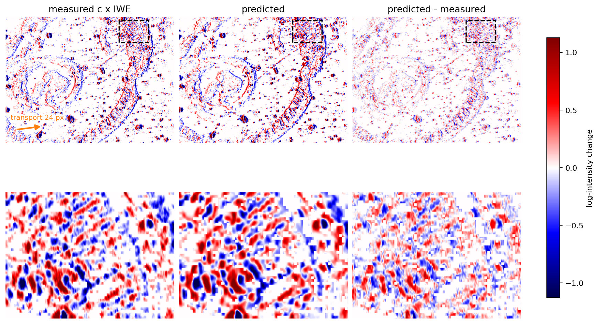
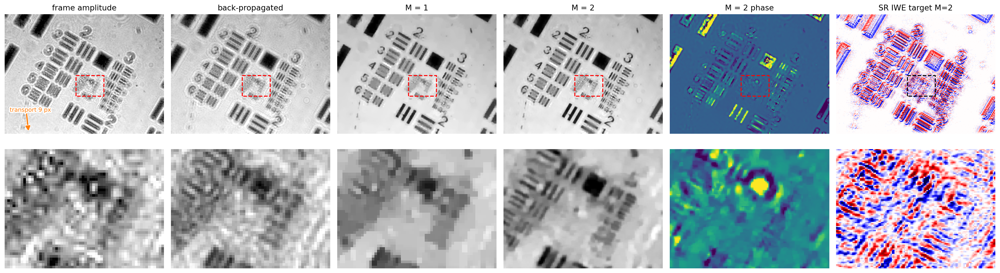
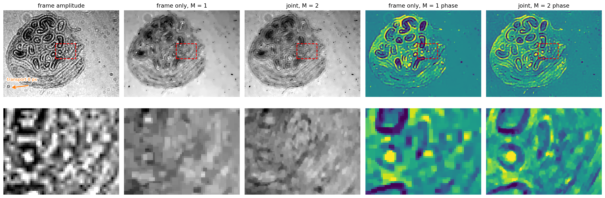

# NeuroSR

**Neuromorphic high-throughput imaging via transport-induced differential sensing**

A DAVIS pixel reads one photodiode twice: as an exposure-averaged frame, and as a stream of
events, each marking that the log-intensity has moved by one contrast threshold. When the scene is
transported across the pixel lattice, the log-intensity at a pixel changes at the rate
$`-\nabla L\cdot\mathbf{v}`$, so the events carry the spatial gradient along the transport in
their timing, and referred back along the transport they fall between the pixel centres. NeuroSR
inverts the two records together. The frame anchors the photometry; the events restore, along the
direction of transport only, the gradients that the exposure integrates and the sensor lattice
undersamples.

<p align="center"></p>

*An earthworm transverse section moved on a manual stage under a wide-field microscope, recorded
with a DAVIS346 (260 × 346 pixels, 18.5 µm pitch). Left: the APS frame, blurred by its 34 ms
exposure. Centre: the event-based double integral (EDI) of that frame, on the sensor grid. Right:
NeuroSR on a grid three times finer, from the same frame and the 100 ms of events that start with
it; a second exposure enters only the fit of the contrast threshold. The arrow gives the
transport over the window, which is the direction of the gain in resolution. Bottom row: the
boxed region. This is `reconstruction.png` as written by the first command below.*

This repository is the minimal runnable implementation that accompanies

> C. Wang, S. Zhu, N. Chen, J. Wu, S. Li, Y. Li, Y. Zhu, R. Chen, Y. Zhang and E. Y. Lam,
> "Neuromorphic High-Throughput Imaging via Transport-Induced Differential Sensing", under review.

The recordings are public at https://doi.org/10.6084/m9.figshare.33545614.

## Quick start

Python 3.10 or newer. Install PyTorch first if you want a CUDA build
(https://pytorch.org/get-started), then

```bash
git clone https://github.com/ChutianWong/isl_diff_event.git
cd isl_diff_event
python -m pip install -e .
```

Three windows are bundled, each 100 ms of events starting with an APS exposure. Start with the
first:

```bash
python -m neurosr joint data/joint/earthworm.npz --output results/earthworm
python -m neurosr joint data/joint/testis.npz --output results/testis
python -m neurosr data/holography/usaf_veryclose --output results/usaf
```

| Example | Scene | M | Time on an RTX 5080 | A full run fits | Writes |
|---|---|---|---|---|---|
| `earthworm` | wide-field microscopy, intensity | 3 | 32 s | $`c`$ = 0.171 | `reconstruction.png`, `iwe.png`, `result.npz`, `result.json` |
| `testis` | lensless inline holography, complex field | 2 | 103 s | $`c`$ = 0.222, $`z`$ = 16.96 mm | the same four files |
| `usaf_veryclose` | lensless inline holography, complex field | 2 | 123 s | $`z`$ = 17.27 mm | `summary.png`, `iwe_native_and_sr.png`, `reconstruction.npz`, `metadata.json` |

M is the ratio of the reconstruction grid to the sensor grid along each axis, $`c`$ the contrast
threshold and $`z`$ the propagation distance. The times are wall clock for the whole command with
PyTorch 2.10 and CUDA 12.8. `--device cpu` runs the same code; the earthworm example then takes
about 4.5 min on a Core Ultra 7 265K with four threads. Adding `--tiny` to any of the three
commands runs five updates per stage in 10 to 25 s on a CPU. That checks the installation; it is
not a result.

## What the events measure

Under brightness constancy the log-intensity $`L=\log I`$ at a pixel changes as the scene moves
with velocity $`\mathbf{v}`$:

```math
L(\mathbf{x},t)\;\approx\;\underbrace{\log I(\mathbf{x},t_0)}_{\text{anchor, from the frame}}
\;-\;\underbrace{\nabla L(\mathbf{x},t_0)\cdot\mathbf{v}(\mathbf{x},t_0)}_{\text{gradient feature, from the events}}\,(t-t_0).
```

An event marks each time $`L`$ has moved by $`\pm c`$. Over a stretch of the transport with
displacement $`\mathbf{D}_k`$, the signed event count at a pixel times $`c`$ therefore measures
the change $`-\nabla L\cdot\mathbf{D}_k`$. Warping the events of that stretch back along the
transport to a common reference time gives an image of warped events (IWE): a signed map of
log-intensity change on a grid finer than the sensor, one for each segment of the transport. The
gain is directional. Events constrain the gradient component along the transport and say nothing
across it.

<p align="center"></p>

*The event record of the example above at M = 3, summed over the twelve transport segments
(`iwe.png`). Left: the measured IWE scaled by the fitted contrast threshold. Centre: the
log-intensity change that the reconstruction predicts through the pixel aperture. Right: their
difference, on the same colour scale. Pixels outside the support of the event term are blank.*

NeuroSR recovers the object $`O`$ by minimizing a frame fidelity, an event fidelity and
regularizers, tied together by one forward model $`I=f_\Theta(O)`$:

```math
\min_{O,\mathbf{v},\Theta}\;
\mathcal{D}_F\Big\{\mathbf{b}_F,\ \tfrac{1}{\Delta t}\!\int_T I\,\mathrm{d}t\,\big\downarrow\Big\}
+\alpha\,\mathcal{D}_E\big\{\mathbf{b}_E(\mathbf{v}),\ -\nabla L\cdot\mathbf{v}\big\}
+\sum_n\beta_n\mathcal{R}_n(O,\mathbf{v}).
```

$`\mathbf{b}_F`$ is the frame, $`\mathbf{b}_E`$ the event record, and $`\downarrow`$ the average over the
pixel aperture followed by sampling on the sensor lattice. For microscopy the object is the
intensity itself. For holography $`O`$ is a complex field, $`f_\Theta(O)=|P_z\{O\}|^2`$ is
angular-spectrum propagation, and $`\Theta`$ is the distance $`z`$, refined with the field.

This is the general form. The release evaluates it with these choices:

- The transport is one trajectory for the whole field of view, continuous and piecewise linear,
  with twelve segments $`\mathbf{D}_k`$ over the 100 ms window. It is fitted to the events alone
  by contrast maximization (CMax), from a start by phase correlation of event images, and then
  held.
- The event fidelity compares, segment by segment, the measured IWE with the finite step
  $`|\mathbf{D}_k|\,[L(\mathbf{x})-L(\mathbf{x}+\mathbf{u}_k)]`$ of the predicted log-intensity,
  where $`\mathbf{u}_k`$ is one grid pixel along $`\mathbf{D}_k`$. $`L`$ is the sensor response,
  logarithmic above a small linear knee.
- The frame fidelity does not evaluate the exposure integral. The frame is either referred to its
  exposure centre with the events (EDI) or short enough to be taken as sharp, and the
  pixel-aperture average of the latent is compared with it.
- The reconstruction runs offline. Nothing here is real time.

## What this release implements

| | `python -m neurosr joint WINDOW.npz` | `python -m neurosr ACQUISITION_DIR` |
|---|---|---|
| Input | two consecutive APS exposures and 100 ms of events | one APS exposure and 100 ms of events, with `config.yaml` |
| Frame record | the first exposure, referred to its centre by EDI; one effective $`c`$ for both polarities is fitted beforehand between the two exposures | a 3 ms exposure taken as sharp and compared in amplitude |
| Event fidelity | segmented IWE scaled by $`c`$, plus an event-wise (EW) vote: the log-intensity increment between consecutive events of a pixel against $`\pm c`$, splatted along the transport; the two are weighted equally at the first step | segmented IWE after normalization, which removes $`c`$ |
| Forward model | intensity with a sparse sensor-fixed background, or complex field with distance | complex field with distance |
| Regularizers | intensity: isotropic TV of $`\log(I+0.02)`$ at M, weight 0.02, and sparsity of the background at M = 1; complex field: anisotropic TV of the field, weight 0.04, and Laplacian of the hologram, weight 0.001 | anisotropic TV of the field, weight 0.04, and Laplacian of the hologram, weight 0.001 |
| Stages | $`c`$, EDI anchor, CMax; then for an intensity a joint fit at M = 1 and at M, for a complex field an autofocus scan, a frame-only fit of field and distance at M = 1 and the joint fit at M | CMax, autofocus scan, frame-only fit of field and distance at M = 1, joint fit at M |
| Settings | constants at the top of `src/neurosr/joint.py` and `joint_demo.py` | `config_neurosr.yaml`, every key documented in `data/_template` |

The first route is the full configuration: both event terms, and a frame record deblurred by
EDI. All three terms see the latent through the same aperture, a box average over one native
pixel taken before the logarithm. The second route is the short-exposure case, in which the frame
needs no deblurring and the normalized event term needs no contrast threshold; its event
prediction is taken on the fine grid, without the aperture. The testis window also has a 3 ms
exposure. It runs through the first route to show a complex field with both event terms, and its
frame-only start at M = 1 uses the exposure as it is.

Limits to keep in mind:

- One trajectory serves the whole field, so the motion within a window must be a translation. It
  may be non-uniform in time.
- The model assumes brightness constancy and, in the first route, one contrast threshold for both
  polarities.
- The gain in resolution is along the transport. Across it, the result follows the frame and the
  regularizer. The transport of the three examples is 24 px mostly along x, 8 px along x, and
  9 px mostly along y.
- The zoom box of every figure is placed by a rule and not by hand: it is the window in which the
  event image at M carries the most energy above the sensor Nyquist frequency, after a square
  root of its magnitude so that the density of fine edges counts and not the contrast of a few
  strong ones. This score selects a display region from the processed IWE. Every panel of a
  figure shows the same native pixels.

The release does not contain the comparison methods, the pipelines for the relay, rotation,
macroscopic and wafer-scanning recordings, or the scripts that drew the figures of the paper. The
three examples show the method on recordings of the public dataset; they are not those scripts.

```
src/neurosr/    events.py, frame.py, edi.py    the event and frame measurement models, EDI
                motion.py, optics.py           transport and angular-spectrum propagation
                model.py, joint.py             the objectives and their fits
                joint_demo.py, __main__.py     the stages of the first route; the command line
                ops.py                         event images, the log response, priors, registration
                config.py, data.py             settings and window loading of the second route
                visualize.py                   the result figures
data/           the bundled windows and the configuration template
tools/          cut a window from an AEDAT4 recording
tests/          short CPU runs against stored references
docs/figures/   the figures of this page, as written by the three commands
source_data/    the numerical values behind the graphs of the paper
```

## Results of the other two examples

<p align="center"></p>

*`usaf_veryclose` (`summary.png`). A 1951 USAF target in lensless inline holography at 632.8 nm.
From the left: hologram amplitude, its back-propagation at the autofocus distance, the frame-only
field at M = 1, the joint field at M = 2 in amplitude and in phase (radians, relative to the mean
field), and the IWE at M = 2. The zoom falls on groups 4 and 5 of the target. The lines of group 4
are 31 to 17.5 µm wide, against a pixel pitch of 18.5 µm.*

<p align="center"></p>

*`testis` (`reconstruction.png`). Testis tissue in the same holographic setup. From the left:
hologram amplitude, the frame-only field at M = 1 and the joint field at M = 2, in amplitude and
in phase.*

## Data

| Bundled window | Recording in the public dataset | APS frame | Exposure | Events | Transport |
|---|---|---|---|---|---|
| `data/joint/earthworm.npz` | `01_microscopy.zip`, `microscopy_01/recording_012.aedat4` | 7 | 34.1 ms | 209,562 | 24 px |
| `data/joint/testis.npz` | `03_holography.zip`, `holography/recording_003.aedat4` | 69 | 3.0 ms | 221,528 | 8 px |
| `data/holography/usaf_veryclose` | `03_holography.zip`, `holography/recording_001.aedat4` | 82 | 3.0 ms | 239,118 | 9 px |

Frame indices are zero-based; the transport is the fitted displacement over the window. The
earthworm and USAF windows are the ones listed for those recordings in the Source Data workbook
(sheets `Fig 4` and `Fig 3`). Each window is cut from its recording by a script in `tools/` and
can be regenerated bit for bit. The commands, the file formats, the SHA-256 of each recording and
the steps for a recording of your own are in [data/README.md](data/README.md).

## Outputs

`result.npz` of the first route holds

- `frame` and `edi`, the first exposure and its EDI anchor;
- `joint`, the fitted sensor intensity on the fine grid. For an intensity this is the
  reconstruction, with `intensity_m1` the fit at M = 1. For a complex field it is the hologram
  $`|P_z\{O\}|^2`$, and the reconstruction is `object_sr`, with `object_m1` the frame-only field;
- `iwe_measured`, `iwe_predicted`, `iwe_residual` and `iwe_support`, the segmented IWE scaled by
  $`c`$, its prediction, their difference and the pixels that enter the event term;
- `segments_px`, the transport segments in sensor pixels, with `background` and `sr_seed`, the
  sensor-fixed background and the start of the fit at M.

`result.json` holds the fitted contrast threshold, the loss history, the weights of the two event
terms, the versions of Python, NumPy and PyTorch, and the SHA-256 of the window and of every
source file. The second route writes its fields, event images, transport and distances to
`reconstruction.npz` and its settings, histories, versions and checksums to `metadata.json`; its
`c` is the starting value, which that route never fits. Each run needs an output directory that
does not exist yet, outside `data/`.

## Reproducibility

A single-threaded CPU run is deterministic. The tests rerun five updates per stage of the three
bundled windows on one thread and compare with stored references, in one to two minutes:

```bash
python -m pip install -e ".[test]"
python -m pytest -q
python -m pytest -q --bitwise
```

The first form compares images on 16 × 16 sampled pixels to 0.1 % in relative L2 norm, and
trajectories and scalars to 0.001 %; it passes across CPU instruction sets. The second compares
the samples to 5e-7 and the SHA-256 of every full array, and holds on the platform that wrote the
references, which `tests/reference/provenance.json` records. CUDA runs are not bit-identical: two
runs of the same example differed by up to 0.5 % in relative L2 norm of the reconstruction, and a
CPU run of the earthworm example differed from a CUDA run by 0.05 %.

The code was run with Python 3.10, PyTorch 2.10, NumPy 2.2, SciPy 1.15, scikit-image 0.24 and
Matplotlib 3.10 on Windows 11.

## Source Data

[`source_data/Source Data.xlsx`](source_data/Source%20Data.xlsx) contains the numerical values
underlying the graphs of the paper, one worksheet per figure. Its Inventory sheet lists every
panel, and its Rerun notes sheet describes the series that were regenerated from the recordings.

## Citation

Until the paper is published, please cite the manuscript and this repository; a
[`CITATION.cff`](CITATION.cff) is provided. The dataset has its own DOI,
[10.6084/m9.figshare.33545614](https://doi.org/10.6084/m9.figshare.33545614).

```bibtex
@unpublished{wang2026neurosr,
  author = {Wang, Chutian and Zhu, Shuo and Chen, Ni and Wu, Jingqian and Li, Shuo and Li, Yuxing
            and Zhu, Yanmin and Chen, Rongzhou and Zhang, Yunping and Lam, Edmund Y.},
  title  = {Neuromorphic High-Throughput Imaging via Transport-Induced Differential Sensing},
  note   = {Manuscript under review},
  year   = {2026}
}
```

## Rights and notices

See [NOTICE.md](NOTICE.md). Components derived from third-party code are listed with their
licences in [THIRD_PARTY_NOTICES.md](THIRD_PARTY_NOTICES.md).
